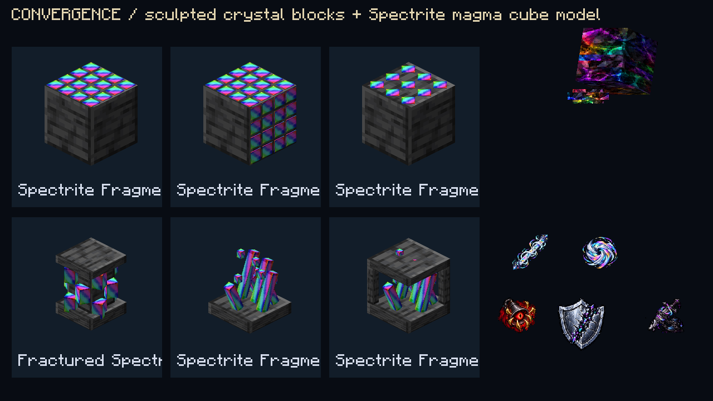
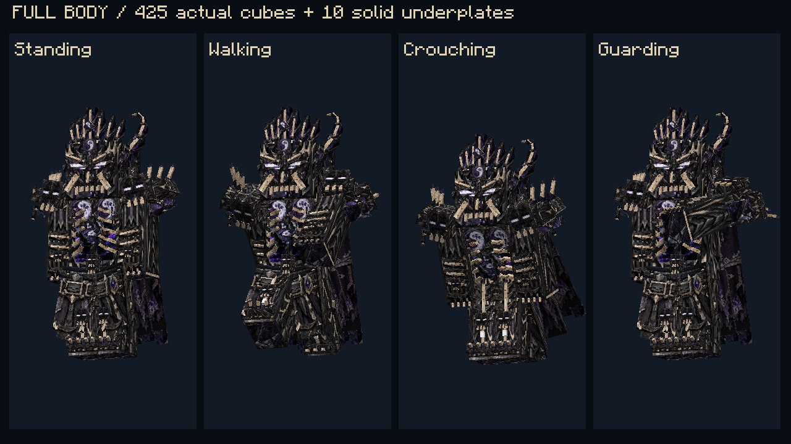

# Spectrite 1.14.0 — Convergencia

**Minecraft 1.21.1 · NeoForge 21.1.172 · Java 21.** Instala una sola versión de Spectrite, la misma en cliente y servidor. La versión 1.14 fusiona el archivo 1.9.0-pre1 enviado por el usuario con las ampliaciones posteriores e integra su propio fuego.

- [Descargar JAR directamente](https://raw.githubusercontent.com/bastian-lopez-benitez/-/refs/heads/spectrite-download-1.10.0/spectrite-1.21.1-1.14.0-almas-convergencia.jar)
- [Descargar ZIP de instalación](https://raw.githubusercontent.com/bastian-lopez-benitez/-/refs/heads/spectrite-download-1.10.0/spectrite-1.21.1-1.14.0-almas-convergencia.zip) — contiene únicamente el JAR; extráelo en `mods`.
- [Fuentes y recursos de bloques para adaptar a 1.20.1](https://raw.githubusercontent.com/bastian-lopez-benitez/-/refs/heads/spectrite-download-1.10.0/spectrite-1.14.0-bloques-fuentes-para-port-1.20.1.zip) — recursos convertidos y fuentes 1.21.1 para adaptar, no es un mod ejecutable de Forge 1.20.1.

Incluye 25 mazmorras terrestres con conexiones, temas, población y campeones por perfil, cinco monumentos oceánicos con guardianes y campanas de aire, 39 especies hostiles en su forma de Spectrita, seis bloques de fragmentos, equipo escalado y recompensas por peligro. Los campeones y mobs tienen ataques anunciados de nueve familias.

El Breeze de Spectrita tiene cuerpo y viento prismáticos. Suelta 1–2 Barras Spectral; cada barra produce cuatro cargas cromáticas con el doble de empuje vanilla. Los impactos aplican Provocación y Debilidad cromática. Las perlas de Spectrita se apilan a 32.

Se conservan el Señor de la Muerte, su armadura 3D y arsenal, la Monstruosidad y su molde exclusivo, las dos formas Wither, la Forja del Réquiem, ojo activo, saltos, regeneración con hambre y barras discretas. El arco del Trono del Vacío dispara tres calaveras guiadas; la munición decide Wither II/III/IV y daño persistente. Almas por bajas; furia por impactos. Los detalles y controles están en [la guía completa](README_TIER.md).

[Catálogo de 30 expediciones y jefes](EXPEDICIONES.md) · [Validación](VALIDACION.md) · [Preparación del port 1.20.1](PORT_1_20_1.md) · [SHA256](SHA256SUMS.txt)

Validación: **196 pruebas de servidor, 0 fallos; 50 comprobaciones del cliente nativo, salida normal**. El cliente gráfico usa vistas de modelos e interfaz sin generar un mundo; la colocación de piezas y el combate se verifican por separado en servidor.

# Historial de versiones

Las versiones históricas 1.9.1–1.12.0 usaban Soul Fire’d, Prometheus y Cobweb. 1.14 integra el fuego propio y no exige esas dependencias.

## Descargas

| Versión | JAR | ZIP alternativo |
| --- | --- | --- |
| 1.12.0 — tres calaveras según carga, dos formas Wither y saltos persistentes | [Descargar JAR](https://raw.githubusercontent.com/bastian-lopez-benitez/-/refs/heads/spectrite-download-1.10.0/spectrite-1.21.1-1.12.0-almas-wither.jar) | [Descargar ZIP](https://raw.githubusercontent.com/bastian-lopez-benitez/-/refs/heads/spectrite-download-1.10.0/spectrite-1.21.1-1.12.0-almas-wither.zip) |
| 1.11.0 — arsenal del Segador, Corrupción y nuevos modelos | [Descargar JAR](https://raw.githubusercontent.com/bastian-lopez-benitez/-/refs/heads/spectrite-download-1.10.0/spectrite-1.21.1-1.11.0-almas-reaper.jar) | [Descargar ZIP](https://raw.githubusercontent.com/bastian-lopez-benitez/-/refs/heads/spectrite-download-1.10.0/spectrite-1.21.1-1.11.0-almas-reaper.zip) |
| 1.9.1 — Señor de la Muerte, Custodia y Sello | [Descargar JAR](https://github.com/bastian-lopez-benitez/-/raw/refs/heads/spectrite-download-1.10.0/spectrite-1.21.1-1.9.1-almas-overlord.jar?download=1) | [Descargar ZIP](https://github.com/bastian-lopez-benitez/-/raw/refs/heads/spectrite-download-1.10.0/spectrite-1.21.1-1.9.1-almas-overlord.zip?download=1) |
| 1.10.0 — añade la Monstruosidad de Spectrita y el molde exclusivo | [Descargar JAR](https://github.com/bastian-lopez-benitez/-/raw/refs/heads/spectrite-download-1.10.0/spectrite-1.21.1-1.10.0-almas-monstrosity.jar?download=1) | [Descargar ZIP](https://github.com/bastian-lopez-benitez/-/raw/refs/heads/spectrite-download-1.10.0/spectrite-1.21.1-1.10.0-almas-monstrosity.zip?download=1) |

Cada ZIP contiene únicamente su JAR. Instala una sola versión de Spectrite en mods y sustituye el JAR anterior. Si descargas ZIP, extráelo primero. Usa la misma versión en cliente y servidor.

El Sello del Sepulcro solo permite escapar mediante el impacto de una perla de ender de Spectrita de su propietario. Llevar una en la mano o el inventario no permite otros teletransportes.

La versión 1.10.0 incluye modelo 3D propio y animaciones del jefe, ataques con avisos y ventanas de recuperación, escudo de reactor y segunda fase. Al derrotarlo con crédito del jugador entrega cuatro moldes; el molde no tiene receta de fabricación ni duplicación. Las cuatro mejoras de armadura requieren un molde por pieza.

Validación: 35 pruebas de servidor en 1.9.1; 52 en 1.10.0 y 12 comprobaciones del cliente nativo. No se ha realizado una partida multijugador manual. SHA256SUMS.txt permite comprobar la integridad de los archivos.

## Novedades 1.11.0

Z: dash físico de 7 bloques con un golpe por enemigo y Wither I. X: habilidad de la herramienta; agacharse + X con la guadaña atrae enemigos. C: Corrupción, 12 segundos de cortes con Wither II a cambio de reducir la vida máxima un 25 %. Hay costes y enfriamientos para impedir encadenar todas las armas al cambiarlas.

La guadaña tiene cosecha amplia, curación limitada a una baja por activación, cadenas y un combo de tres golpes cargados. Espada, hacha, pico, pala, arco y escudo tienen habilidades diferentes. Las cuatro piezas de armadura incorporan utilidades propias.

Escudo 3D con frontal curvado y agarre trasero: 215 cubos, poses corregidas en ambas manos. Guadaña 3D de 146 cubos con el filo hacia delante.

Validación 1.11.0: 73 pruebas de servidor aprobadas y 21 comprobaciones del cliente gráfico. Incluye el jefe y el molde exclusivo de 1.10.0. No se ha realizado una partida multijugador manual. Los controles se pueden cambiar en Opciones → Controles.

## Novedades 1.12.0

El Arco del Trono del Vacío dispara tres calaveras de Spectrita por una munición, en abanico fijo y sin perseguir enemigos. Cada calavera causa 16 × fuerza de carga de daño base: al tensarlo por completo son 16 puntos, el doble de una calavera normal del Wither, antes de encantamientos y defensas. Aplican Wither II, Corrupción, Aberración Cromática y quemadura de almas después de causar daño real. Salva de ánimas potencia solo la calavera central.

Con el conjunto completo y la Guadaña del Ocaso en la mano: agacharse 5 s transforma en Wither normal durante 20 s (300 PV); R con 100 almas activa el Wither de Spectrita durante 25 s (750 PV). Recarga compartida de 180 s. X ejecuta ataques anunciados y Z una carga física; la forma de Spectrita alterna salva, onda saltable y lluvia. Al terminar se restaura la salud habitual sin curación gratuita.

Con la armadura completa puedes hacer tres saltos extra con Espacio y eres inmune a la caída. Cada salto suena como un disparo del Wither y deja caer una poción persistente de Wither I: nube y efecto de 5 s, sin daño a aliados. Al quedar en el 25 % de vida, la coraza animada del Wither permite únicamente daño directo cuerpo a cuerpo y desvía proyectiles hacia delante. Se conservan las dos resurrecciones y la regeneración anteriores.

Las bajas conceden 20 almas con la guadaña, 10 con otras armas/herramientas de este tier y 5 durante ambas transformaciones. Máximo 100. El yunque de Spectrita tiene identidad propia y es la estación para encantar este equipo con libros; se rechazan el yunque normal y la mesa de encantamientos.

Validación 1.12.0: **116 pruebas de servidor aprobadas y 31 comprobaciones del cliente gráfico**, con cierre normal. El cliente de validación dibuja modelos y estados de interfaz sin crear un mundo; no sustituye una partida multijugador manual.
